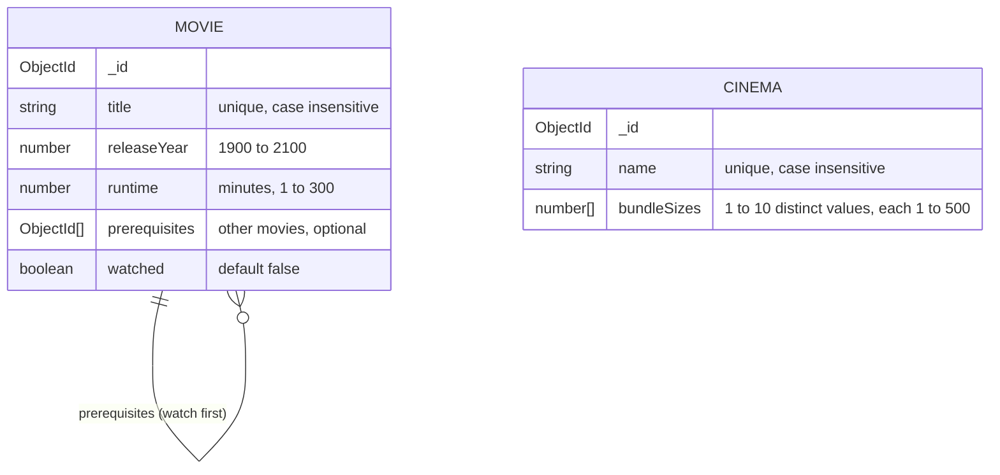

# Doomsday Ready

A small full-stack app that helps MCU fans plan their rewatch before **Avengers: Doomsday** and book an opening night watch party.

- **Movies:** add movies, set which movies to watch first, tick the ones you have seen.
- **Rewatch Plan:** pick a target movie and get every movie you need first, in a valid order, with progress and remaining watch time.
- **Booking:** pick a cinema and a group size and get the fewest seat bundles that add up to exactly that group size.

Built for the Blinto Talent Accelerator 2027 Full Stack Developer Internship assessment.

## Tech stack

| Part | Technology |
|---|---|
| Frontend | Next.js 16 (App Router), React 19, TypeScript, Tailwind CSS 4, Axios, React Hook Form, Zod |
| Backend | Node.js, Express 5, TypeScript, Zod |
| Database | MongoDB with Mongoose 9 |
| Tests | Vitest |

The task asks for a React app. Next.js is a React framework, and here it is used only as the frontend: every page is a client component that calls the Express API with Axios. The API lives entirely in the Express server, so no Next.js route handlers or server actions are used.

## Project structure

```
doomsday-ready/
├── server/                     Express API
│   ├── src/
│   │   ├── config/db.ts        MongoDB connection
│   │   ├── models/             Movie and Cinema schemas
│   │   ├── validators/         Zod schemas for request bodies and queries
│   │   ├── controllers/        Request handlers
│   │   ├── routes/             Express routers
│   │   ├── services/           Pure algorithm functions (no database, no Express)
│   │   │   ├── cycleCheck.ts       Feature 1: circular dependency check
│   │   │   ├── rewatchOrder.ts     Feature 1: rewatch order
│   │   │   └── bookingQuote.ts     Feature 2: fewest bundles
│   │   ├── middlewares/        404 and error handler
│   │   ├── utils/AppError.ts   Error with HTTP status and error code
│   │   ├── scripts/seed.ts     Loads the sample data from the task
│   │   ├── app.ts              Express app and routes
│   │   └── server.ts           Starts the server after MongoDB connects
│   └── tests/                  Unit tests for the three algorithms
└── client/                     Next.js frontend
    └── src/
        ├── app/                Pages: /movies, /rewatch-plan, /booking
        ├── components/         Navbar, forms, list, progress bar, booking result
        ├── lib/api/            Axios client and API calls
        └── types/              Shared TypeScript types
```

## Data model



A movie stores its prerequisites as an array of other movie ids. Together the movies form a directed graph that must never contain a cycle. Cinemas are independent documents; a booking quote is calculated on request and is not stored.

## Getting started

### Requirements

- Node.js 22.12 or newer
- MongoDB, either running locally or a MongoDB Atlas connection string

### 1. Clone

```bash
git clone <your-repo-url>
cd doomsday-ready
```

### 2. Backend

```bash
cd server
npm install
cp .env.example .env
```

Edit `server/.env` if needed:

```
PORT=5000
MONGODB_URI=mongodb://127.0.0.1:27017/doomsday-ready
CLIENT_URL=http://localhost:3000
```

Load the sample data from the task (8 movies and 4 cinemas). This deletes any existing movies and cinemas first.

```bash
npm run seed
```

Start the API:

```bash
npm run dev
```

The API runs at `http://localhost:5000/api`. Check it with `http://localhost:5000/api/health`.

### 3. Frontend

In a second terminal:

```bash
cd client
npm install
cp .env.example .env.local
npm run dev
```

`client/.env.local`:

```
NEXT_PUBLIC_API_URL=http://localhost:5000/api
```

Open `http://localhost:3000`.

### Scripts

| Folder | Command | What it does |
|---|---|---|
| server | `npm run dev` | Start the API and restart on file changes |
| server | `npm run build` | Compile TypeScript to `dist` |
| server | `npm start` | Run the compiled API |
| server | `npm run seed` | Replace all data with the sample data |
| server | `npm test` | Run the unit tests |
| server | `npm run typecheck` | Type check without building |
| client | `npm run dev` | Start the frontend |
| client | `npm run build` | Production build |
| client | `npm run lint` | Lint the frontend |

## Tests

```bash
cd server
npm test
```

25 unit tests cover the three algorithm functions. They include every expected result listed in the task:

| Case | Expected | Covered |
|---|---|---|
| Rewatch order for Avengers: Doomsday | All 7 other movies in a valid order | Yes |
| Rewatch order for Captain America: Civil War | Iron Man and The First Avenger, then The Avengers | Yes |
| Rewatch order for Thor: Ragnarok | Empty list | Yes |
| Make Avengers: Endgame a prerequisite of Iron Man | Cycle detected (409 CIRCULAR_DEPENDENCY from the API) | Yes |
| Bundles 1, 3, 4 and group 6 | 2 bundles: 3 × 2 | Yes |
| Bundles 2, 5 and group 11 | 4 bundles: 5 × 1, 2 × 3 | Yes |
| Bundles 6, 9, 20 and group 44 | 4 bundles: 20 × 1, 9 × 2, 6 × 1 | Yes |
| Bundles 4, 6 and group 7 | Not possible | Yes |

The rewatch order tests check the ordering rule (every movie after its prerequisites) instead of one fixed order, because the task allows any valid order.

## API reference

All endpoints are under `/api`. Request and response bodies are JSON.

| Method and path | Purpose |
|---|---|
| `GET /health` | Health check |
| `POST /movies` | Create a movie |
| `GET /movies` | List movies |
| `PATCH /movies/:id` | Update any movie field, including `watched` and `prerequisites` |
| `GET /movies/:id/rewatch-order` | Rewatch order for a target movie |
| `POST /cinemas` | Create a cinema |
| `GET /cinemas` | List cinemas |
| `GET /cinemas/:id/booking?groupSize=6` | Booking quote |

### Create a movie

`POST /api/movies`

```json
{
  "title": "The Avengers",
  "releaseYear": 2012,
  "runtime": 143,
  "prerequisites": ["<Iron Man id>", "<The First Avenger id>"],
  "watched": false
}
```

`title`, `releaseYear` and `runtime` are required. `prerequisites` and `watched` are optional. Returns `201` with the created movie.

### Update a movie

`PATCH /api/movies/:id` with any subset of the fields above, for example `{ "watched": true }` or `{ "prerequisites": ["<id>"] }`. At least one field is required. Returns `200` with the updated movie.

### Rewatch order

`GET /api/movies/:id/rewatch-order`

```json
{
  "target": { "id": "...", "title": "Captain America: Civil War" },
  "order": [
    { "_id": "...", "title": "Iron Man", "releaseYear": 2008, "runtime": 126, "prerequisites": [], "watched": true },
    { "_id": "...", "title": "Captain America: The First Avenger", "releaseYear": 2011, "runtime": 124, "prerequisites": [], "watched": false },
    { "_id": "...", "title": "The Avengers", "releaseYear": 2012, "runtime": 143, "prerequisites": ["...", "..."], "watched": false }
  ],
  "watchedCount": 1,
  "totalCount": 3,
  "remainingRuntime": 267
}
```

`remainingRuntime` is the total runtime in minutes of the unwatched movies in `order`.

### Create a cinema

`POST /api/cinemas`

```json
{ "name": "Blockbuster Cinemas", "bundleSizes": [2, 5] }
```

Returns `201` with the created cinema.

### Booking quote

`GET /api/cinemas/:id/booking?groupSize=11`

```json
{
  "cinema": { "id": "...", "name": "Blockbuster Cinemas" },
  "groupSize": 11,
  "possible": true,
  "totalBundles": 4,
  "bundles": [
    { "size": 5, "count": 1 },
    { "size": 2, "count": 3 }
  ]
}
```

When no exact combination exists the status is still `200`:

```json
{
  "cinema": { "id": "...", "name": "Lion Cinemas" },
  "groupSize": 7,
  "possible": false,
  "totalBundles": 0,
  "bundles": []
}
```

### Errors

Every error has the same shape:

```json
{ "error": { "code": "CIRCULAR_DEPENDENCY", "message": "A movie cannot depend on itself, directly or through other movies" } }
```

| Status | Code | When |
|---|---|---|
| 400 | `VALIDATION_ERROR` | Invalid body or query, invalid id, prerequisite that does not exist, invalid JSON |
| 404 | `NOT_FOUND` | Movie, cinema or route not found |
| 409 | `CIRCULAR_DEPENDENCY` | A create or update would make a movie depend on itself |
| 409 | `DUPLICATE_TITLE` | A movie with this title already exists |
| 409 | `DUPLICATE_NAME` | A cinema with this name already exists |
| 500 | `INTERNAL_ERROR` | Unexpected server error |

## How the algorithms work

The three functions in `server/src/services` are pure: they take plain data and return plain data, with no database or Express code. The controllers load the movies or the cinema, call the function, and send the result. No library is used for any of them.

### Circular dependency check

`wouldCreateCycle(movieId, newPrerequisiteIds, graph)`

Setting prerequisites P on movie X creates a cycle exactly when X can be reached by walking backwards from P through prerequisites. The function runs an iterative depth first search starting from the new prerequisites, with a visited set so each movie is explored once, and returns `true` as soon as it reaches X. A new movie has no id yet and no movie points to it, so creating a movie can never create a cycle.

Time: O(V + E), where V is the number of movies and E the number of prerequisite links.

### Rewatch order

`getRewatchOrder(targetId, graph)`

A depth first search from the target. Before a movie is added to the result, all of its own prerequisites are added first (post order), which is a topological sort of the part of the graph the target depends on. A visited set makes sure a movie reached through two paths appears only once. The target itself is never added. Because the cycle check keeps the graph acyclic, the search always ends.

Time: O(V + E).

### Booking quote

`getBookingQuote(bundleSizes, groupSize)`

This is the minimum coin change problem, solved with bottom up dynamic programming. `fewest[s]` is the fewest bundles that seat exactly `s` people, starting from `fewest[0] = 0`. For every `s` from 1 to the group size, each bundle size `b` is tried as `fewest[s - b] + 1` and the smallest is kept, along with the bundle used. If `fewest[groupSize]` is still unreachable the answer is "not possible"; otherwise the stored bundles are walked back to count how many of each size to buy.

A greedy approach (always take the largest bundle) is wrong here: with sizes 1, 3, 4 and a group of 6, greedy gives 4 + 1 + 1 (3 bundles) while the right answer is 3 + 3 (2 bundles).

Time: O(groupSize × number of bundle sizes), at most 10,000 × 10. Memory: O(groupSize).

## Assumptions and decisions

The task asks to make a reasonable choice where something is unclear. These are the choices made:

1. **Release year** must be a whole number from 1900 to 2100. The task gives no range.
2. **Titles and cinema names** are trimmed and unique without regard to letter case, so "Iron Man" and "iron man" count as the same title. A duplicate returns `409 DUPLICATE_TITLE` or `409 DUPLICATE_NAME`.
3. **Prerequisite ids that do not exist** are rejected with `400 VALIDATION_ERROR`. The same id sent twice is stored once.
4. **Booking that is not possible** returns `200` with `possible: false`, because "not possible" is a valid answer to the question and not an error.
5. **Group size** outside 1 to 10,000, not a whole number, or missing returns `400 VALIDATION_ERROR`.
6. **Several equally small bundle combinations:** any one of them is returned. Bundles in the response are sorted from the largest size to the smallest.
7. **Rewatch order** is one valid order out of possibly many. It is stable for the same data.
8. **Rewatch order for a movie with no prerequisites** returns an empty list with `totalCount: 0` and `remainingRuntime: 0`.
9. **An empty PATCH body** returns `400 VALIDATION_ERROR`.
10. **No delete endpoints**, since the task does not ask for them.
11. **Seed data:** release years and runtimes are the real ones. The runtime of Avengers: Doomsday is not known yet, so 150 minutes is used as a placeholder. The four cinema names are invented; their bundle sizes are the four examples from the task.
12. **Extra UI:** the Booking page also has a small form to add a cinema, and the Rewatch Plan page lets you tick movies as watched so the progress updates right away.
13. **Fonts:** the frontend uses the system font instead of a Google Font, so it builds without internet access.

## AI usage

> **TODO: rewrite this section in your own words so it is accurate.** The draft below states what was done with AI in this project. Do not claim work you did not do.

I used Claude (Anthropic) as a coding assistant throughout this project. It was used to:

- plan the project structure and the order of work
- write the backend: models, validation, controllers, routes and the error handler
- write the three algorithm functions (`cycleCheck.ts`, `rewatchOrder.ts`, `bookingQuote.ts`) and their unit tests
- write the frontend pages and components
- write this README

My own part:

- running every step on my machine and checking the results against the expected results in the task
- debugging setup problems (environment files, test files, missing exports)
- reading and understanding the generated code, especially the three algorithms, which are explained above

The task asked for the logic of features 1 and 2 to be written without libraries that solve them. No such library is used: all three algorithms are written from scratch. They were written with AI help, as stated above.
